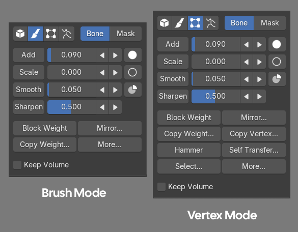
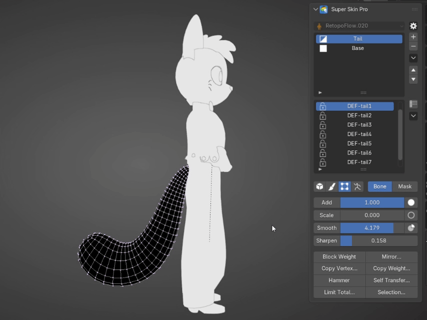
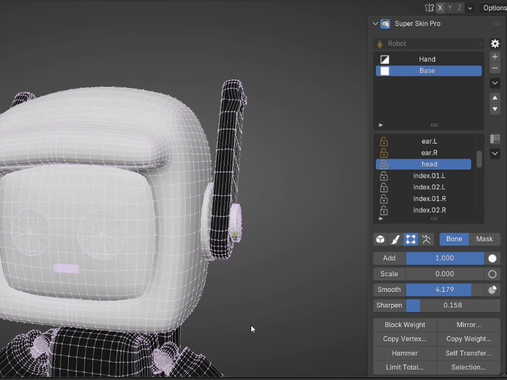

# Paint Weight Tools

<figure markdown>
 
</figure>

 
- - -
 

# Weight Apply

In this video, you'll learn how to apply all weight operations using both brush painting and vertex selection.

  <iframe 
    src="https://www.youtube.com/embed/n2bP1M5w_TI" 
    style="position: absolute; top: 0; left: 0; width: 100%; height: 100%; border: 0;" 
    allow="accelerometer; autoplay; clipboard-write; encrypted-media; gyroscope; picture-in-picture; web-share" 
    allowfullscreen>
  </iframe>

 
- - -
 

# Mirror Weight

In this video, you'll learn how to use mirror weights and their settings.

  <iframe 
    src="https://www.youtube.com/embed/3bBY6CPEP9I" 
    style="position: absolute; top: 0; left: 0; width: 100%; height: 100%; border: 0;" 
    allow="accelerometer; autoplay; clipboard-write; encrypted-media; gyroscope; picture-in-picture; web-share" 
    allowfullscreen>
  </iframe>

Mirrors the weight of the Layer selected in the [Layer List](bone_list.md#layer-list), with the following additional settings:

- **Mirror Axis and Mirror Direction :** sets the World Axis used as the reference.
- **Mirror Target Data :** sets whether to mirror only the Layer Mask or the Bone Weight (both by default).
- **Mapping Keywords :** a list of Wildcard Keywords that identify left and right in the bone Naming Convention.

!!! note "Multiple Layers"
    You can select multiple layers in the Layer List to apply mirror weights across all of them.

!!! note "Selected Vertices"
    If you have selected vertices while mirroring, the mirror will only apply to the selected vertices.

 
- - -
 

### Block Weight

<figure markdown>

</figure>

Automatically calculates weights from the selected bones as follows:

1. Select the bones you want to auto-assign.
2. Click the Block Weight button.

!!! note "Bone Locks"
    Block Weight pulls weight from Bones that are not Locked, so check your Bone Locks carefully for a correct Block Weight result.

!!! note "Face Rings"
    When this option is checked, Block Weight follows the mesh's edge loops more closely. Watch the [Face Rings example](https://youtu.be/D3-zaYN3omA?t=135).

 
- - -
 

### Self Transfer

Transfers weight from a Vertex within the same Mesh, as follows:

1. Select the Vertex to use as the Source, press **Self Transfer...**, then press **Mark Source** in the popup
2. Select the target Vertex (Target), press **Self Transfer...** again, then press **Transfer** in the popup

 
- - -
 

### Copy Vertex Weight

Copy the weight values of a selected vertex to the clipboard.

Steps:

1. Select a single vertex, then click Copy Vertex to copy its weight data to the clipboard.
2. Select the target vertices, then click Paste Vertex to apply the weights.

!!! note
    You can copy and paste across bone and mask modes.

 
- - -
 

### Copy Weight

Copy weights from the active vertex group to the clipboard.

Steps:

1. Copy or Cut: Copy or cut the weights from the current vertex group.
2. Paste: Select the target bone or layer mask, then paste the weights (choose between Add, Replace, or Subtract).

!!! note
    You can copy and paste across bone and mask modes.

 
- - -
 

### Hammer Weight

Click the Hammer button to hammer selected vertices to average their weights.

<figure markdown>
 
</figure>

 
- - -
 

### Multi-Color Preview

Press <kbd>Alt</kbd> + <kbd>3</kbd> to toggle Multi-Color Preview.

!!! note
    Multi-Color mode may impact performance.