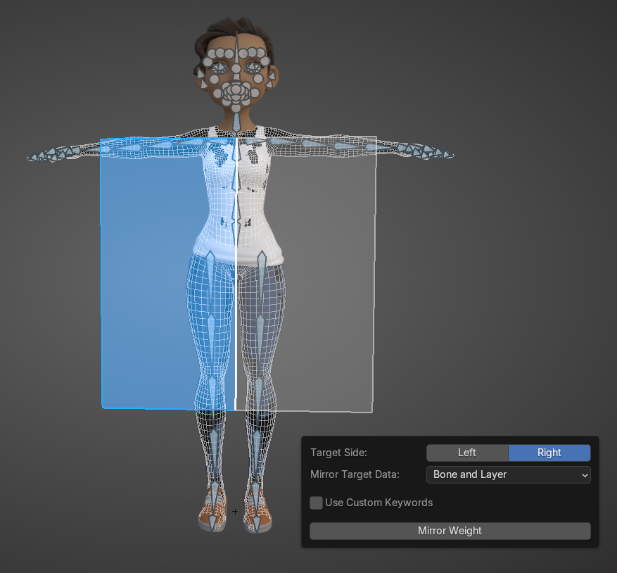
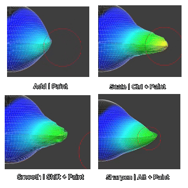
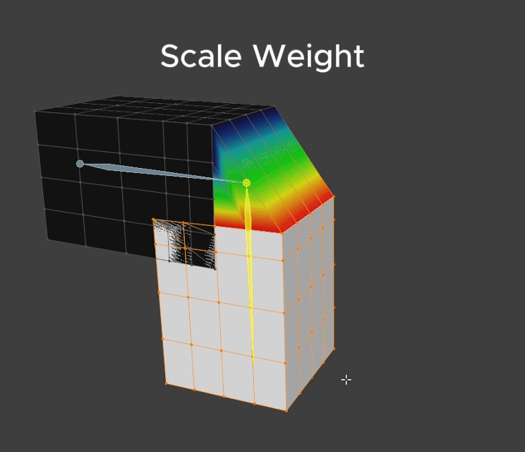
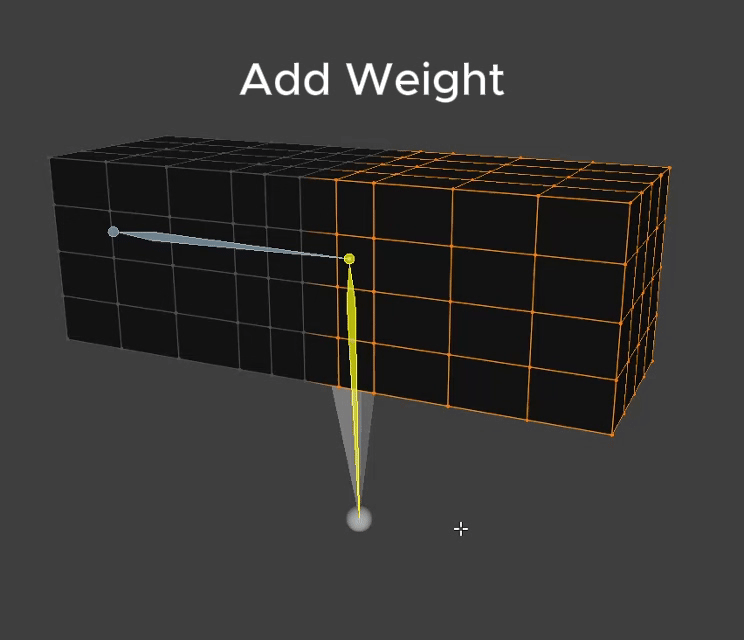
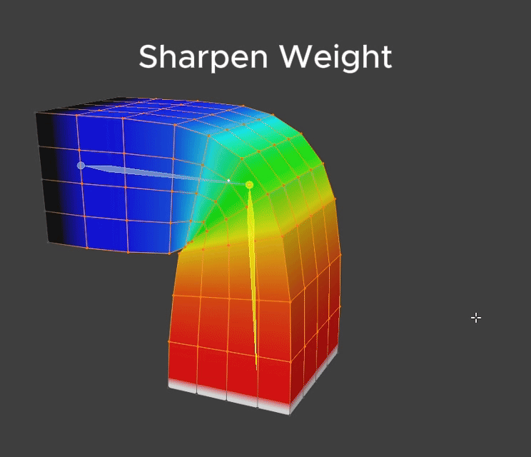
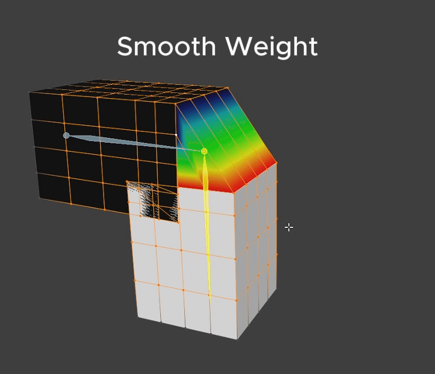

# Quick Start

<figure markdown>
 
  <figcaption>
    Brush Mode and Vertex Selection Mode have different available tools.
  </figcaption>
</figure>

<figure style="margin-bottom: 1.5rem;">
  

    <iframe 
      src="https://www.youtube.com/embed/n2bP1M5w_TI" 
      style="position: absolute; top: 0; left: 0; width: 100%; height: 100%; border: 0;" 
      allow="accelerometer; autoplay; clipboard-write; encrypted-media; gyroscope; picture-in-picture; web-share" 
      allowfullscreen>
    </iframe>
  

  <figcaption>
    In this video, you'll learn how to apply all weight operations using both brush painting and vertex selection.
  </figcaption>
</figure>

 
- - -
 

# General Tools

#### Weight Operation Sliders

<figure markdown>
  
  <figcaption>Used for adjusting weights and quickly flooding values to selected areas.</figcaption>
</figure>

**Add Weight**

- Increases weight strength.
- **Range:** 0.001 – 1.0

**Scale Weight**

- Decreases weight by multiplying it (lower = reduces more, higher = reduces less).
- **Range:** 0.0 – 0.999

**Smooth Weight**

- Blends weights smoothly.
- **Range:** 0.001 – 1.0 (can go up to 100)

**Sharpen Weight**

- Sharpens weight edges.
- **Range:** 0.001 – 1.0

!!! note
    If no vertices are selected, flooding will apply to the entire mesh.

<figure markdown>
  
  <figcaption>Use weight step buttons to smoothly increase or decrease weight values. This makes weights easier to control and perfectly fits the feel of each weight operation.</figcaption>
</figure>

 

#### Block Weight

<figure markdown>

</figure>

Automatically calculates weights from the selected bones as follows:

1. Select the bones you want to auto-assign.
2. Click the Block Weight button.

!!! note "Bone Locks"
    Block Weight pulls weight from Bones that are not Locked, so check your Bone Locks carefully for a correct Block Weight result.

!!! note "Face Rings"
    When this option is checked, Block Weight follows the mesh's edge loops more closely. Watch the [Face Rings example](https://youtu.be/D3-zaYN3omA?t=135).

 

#### Mirror Weight

<figure markdown>
 
</figure>

* **Target Side:** Specifies the target side for mirroring (can be identified via the viewport HUD—the blue plane indicates the target side).
* **Mirror Target Data:** Sets whether to mirror only the Layer Mask or the Bone Weight (both by default).
* **Use Custom Mapping Keywords (Optional):** Allows you to [add custom left and right side keywords](https://youtu.be/3bBY6CPEP9I?t=62) for rigs with non-standard naming conventions. For most general users, there is no need to configure this setting.

!!! note "Multiple Layers"
    You can [select multiple layers](https://youtu.be/D3-zaYN3omA?t=402) to apply mirror weights across all of them.

!!! note "Selected Vertices"
    If you have selected vertices while mirroring, the mirror will only apply to the selected vertices.

 

#### Copy Weight

Copy weights from the active vertex group to the clipboard.

Steps:

1. Copy or Cut: Copy or cut the weights from the current vertex group.
2. Paste: Select the target bone or layer mask, then paste the weights (choose between Add, Replace, or Subtract).

!!! note
    You can copy and paste across bone and mask modes.

 

#### Multi-Color Preview

While in Bone Mode, press <kbd>Alt</kbd> + <kbd>3</kbd> to toggle Multi-Color Preview.

!!! note
    Multi-Color mode may impact performance.

 

#### Keep Volume

<figure markdown>
  
  <figcaption>When Keep Volume is enabled, it automatically maintains mesh distance and seamlessly connects separated seams. Ideal for clothing or multi-part meshes.</figcaption>
</figure>

<figure markdown>
  
  <figcaption>Keep Volume works in all modes—whether you are using brush paint, vertex selection, or clicking flood weight from the N-panel.</figcaption>
</figure>

<figure markdown>
  
  <figcaption>When Keep Volume is enabled in vertex mode, you can select vertices across connected seams as if they were a single mesh.</figcaption>
</figure>

 
- - -
 

# Brush Mode Tools

#### Brush Shortcut

<figure markdown>
  
</figure>

#### Brush Options

<figure markdown>
  
  <figcaption>Brush Mode - <kbd>Right Click</kbd> Popup Option</figcaption>
</figure>

 

#### Brush Falloff
<figure markdown>
  
  <figcaption>You can change the falloff type for the surface brush and projected brush. There are 3 presets: constant, smooth, and linear.</figcaption>
</figure>

 

#### Connected Only Option for Brush
Check the "Connected Only" option to limit weight painting to connected surface parts only.

<figure markdown>
  
</figure>

<figure markdown>
  
</figure>

 

- - - 

 

# Vertex Mode Tools

#### Vertex Paint Weight Gesture

<figure markdown>
  
  <figcaption>Hold <kbd>Alt</kbd> + <kbd>Left Click</kbd> and drag left to Scale Weight</figcaption>
</figure>

<figure markdown>
  
  <figcaption>Hold <kbd>Alt</kbd> + <kbd>Left Click</kbd> and drag right to Add Weight</figcaption>
</figure>

<figure markdown>
  
  <figcaption>Hold <kbd>Alt</kbd> + <kbd>Right Click</kbd> and drag left to Sharpen Weight</figcaption>
</figure>

<figure markdown>
  
  <figcaption>Hold <kbd>Alt</kbd> + <kbd>Right Click</kbd> and drag right to Smooth Weight</figcaption>
</figure>

!!! note
    If no vertices are selected, this will apply to the entire mesh.

 

#### Vertex Options

<figure markdown>
  
  <figcaption>Vertex Mode - <kbd>Right Click</kbd> Popup Option</figcaption>
</figure>

 

#### Self Transfer

<figure markdown>

</figure>

Transfers weight from a Vertex within the same Mesh , as follows:

1. Select the Vertex to use as the Source, press **Self Transfer...**, then press **Mark Source** in the popup
2. Select the target Vertex (Target), press **Self Transfer...** again, then press **Transfer** in the popup

!!! note "Transfer Target"
    The transfer operation affects both bone and mask data of the active layer.

 

#### Copy Vertex Weight

Copy the weight values of a selected vertex to the clipboard.

Steps:

1. Select a single vertex, then click Copy Vertex to copy its weight data to the clipboard.
2. Select the target vertices, then click Paste Vertex to apply the weights.

!!! note
    You can copy and paste across bone and mask modes.

 

#### Hammer Weight

Click the Hammer button to hammer selected vertices to average their weights.

<figure markdown>
 
</figure>
