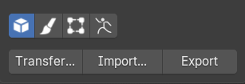
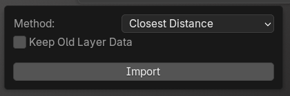

# Object Mode Tools

<figure markdown>

</figure>

- - -

# Weight Transfer

Transferring weights from a source mesh to a target mesh is shown in this [Transfer tutorial video](https://youtu.be/RM6qYHHTqpI?t=544).

It can be used in many ways, such as:

### 1) Transfer weights from the body to clothing and accessories

<figure markdown>
  
</figure>

**How to use:**

1. Add both the body and clothing to the Transfer list.
2. Mark the body mesh as **Source**.
3. Click **Transfer Weight**.

### 2) Transfer weights from multiple meshes

<figure markdown>
  
</figure>

**How to use:**

1. Add the source meshes and the target mesh to the Transfer list.
2. Mark the relevant meshes as **Source**.
3. Click **Transfer Weight**.

---

**Other Transfer Options:**

- You can restrict the transfer to specific source or target areas by enabling the **Use Selected Vertices** toggle (the selection must exist in Edit Mode).

- If the target already has a layer system, the output will be added as a new layer named "Transfer Output".

- Enabling the **Force Target to Init Layer** checkbox forces layer data initialization for all target meshes if they are still using native vertex groups.

!!! note "Armature Parenting"
    Target meshes do not need to be parented to an armature beforehand, as the tool will automatically parent them during the transfer. However, the **source mesh must always be parented to an armature first**.

 
- - -
  

# Weight Export

You can export all the Layer Data and Skin Weight from a selected Mesh to a file, for backing up a version or sending to someone else.

**How to use**

1. Select the Mesh you want
2. Click Export Weights

 
- - -
  

# Weight Import

<figure markdown>

</figure>

How to use:

1. Select the target model.

2. Click the Import button.

- You can choose a weight transfer method when importing, such as Closest Distance or Vertex ID.

- Enable the Keep Old Layer Data checkbox to preserve existing layers on the mesh.