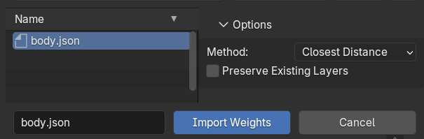

# Object Mode Tools

<figure markdown>

</figure>

- - -

# Weight Transfer

Weight transfer supports any number of source and target meshes. It can be used in various ways, such as:

### 1) Transfer weights from the body to clothing and accessories

<figure markdown>
  
</figure>

**How to use:**

1. Add both the body and clothing to the Transfer list.
2. Mark the body mesh as **Source**.
3. Click **Transfer Weight**.

### 2) Transfer weights from multiple meshes

<figure markdown>
  
</figure>

**How to use:**

1. Add the source meshes and the target mesh to the Transfer list.
2. Mark the relevant meshes as **Source**.
3. Click **Transfer Weight**.

### 3) And much more as demonstrated in the video

  <iframe 
    src="https://www.youtube.com/embed/MsszYELKnHA" 
    style="position: absolute; top: 0; left: 0; width: 100%; height: 100%; border: 0;" 
    allow="accelerometer; autoplay; clipboard-write; encrypted-media; gyroscope; picture-in-picture" 
    allowfullscreen>
  </iframe>

 
**Other Transfer Options:**

- You can restrict the transfer to specific source or target areas by enabling the **Use Selected Vertices Only** toggle (the selection must exist in Edit Mode).

- If the target already has a layer system, the output will be added as a new layer named "Transfer Output".

- Enabling the **Force Target to Init Layer** checkbox forces layer data initialization for all target meshes if they are still using native vertex groups.

!!! note "Armature Parenting"
    Target meshes do not need to be parented to an armature beforehand, as the tool will automatically parent them during the transfer. However, the **source mesh must always be parented to an armature first**.

- - -

# Weight Export

Export all layer data and skin weights from a selected mesh to a file.

**How to use:**

1. Select the mesh you want to export layer data from.
2. Click **Export Weights**.

---

# Weight Import

<figure markdown>
  
</figure>

**How to use:**

1. Select the target mesh you want to import weights to.
2. Click **Import Weights**.

**Options:**

* **Transfer Method:** Choose a weight transfer method during import, such as **Closest Distance** or **Vertex ID**.
* **Preserve Existing Layers:** Check this option to keep current layers on the mesh. *(This option only appears if the target mesh already has layer data.)*