# 1.2.0 ( Minor Update )

## Brush Paint Update

#### - Falloff Preset
<figure markdown>
  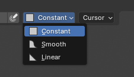
  <figcaption>You can now change the falloff type for surface brush and projected brush. There are 3 presets: constant, smooth, and linear.</figcaption>
</figure>

!!! note "Removed Options"
    - Old falloff pressure and falloff sliders have been removed.
    - Removed size pressure since strength pressure is usually enough for weight painting.

#### - Connected Only Option for Brush
You can now check the "Connected Only" option. This limits your weight painting to only affect the connected surface parts.

<figure markdown>
  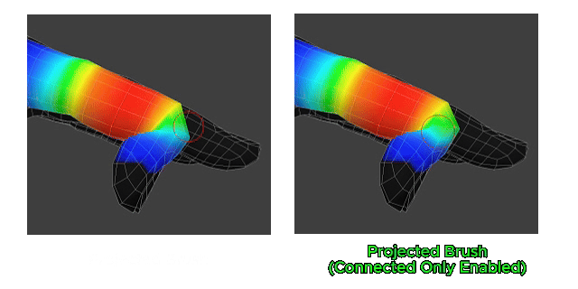
</figure>

<figure markdown>
  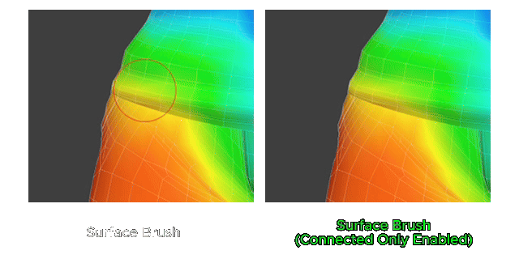
</figure>

#### - Support Off-Mesh Painting when using Surface Brush

<figure markdown>
  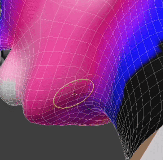
  <figcaption>Surface brush can now be used even when the brush cursor is outside the mesh. This helps you fine-tune silhouettes much easier.</figcaption>
</figure>

#### - Brush HUD Color Customization

<figure markdown>
  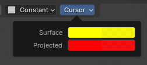
  <figcaption>Now you can change cursor colors in the cursor dropdown menu.</figcaption>
</figure>

## Enhanced Sharpen Weight

<figure markdown>
  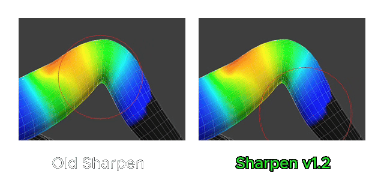
  <figcaption>The new sharpen weight has been heavily improved.</figcaption>
</figure>

## New Behavior: Keep Volume

#### - Easily Paint Weight Clothes!

<figure markdown>
  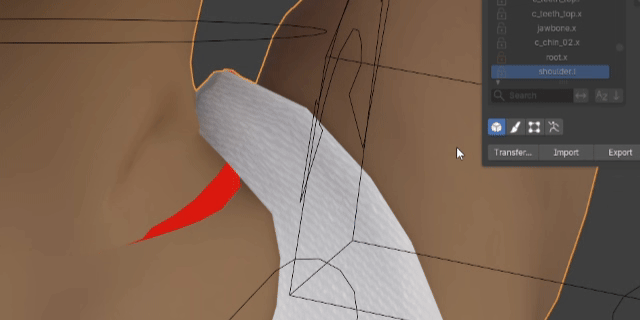
  <figcaption>When Keep Volume is on, it automatically keeps mesh distance and connects separated seams nicely.</figcaption>
</figure>

#### - Not Connected Surface? No More Problem!

<figure markdown>
  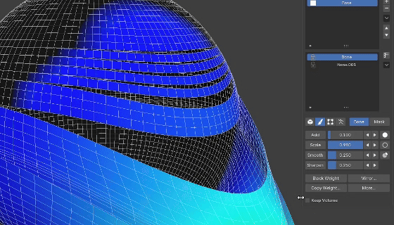
  <figcaption>Keep volume works in all modes—whether you are using brush paint, vertex selection, or clicking flood weight from the N-panel.</figcaption>
</figure>

#### - Keep Separate Surface Selection as One

<figure markdown>
  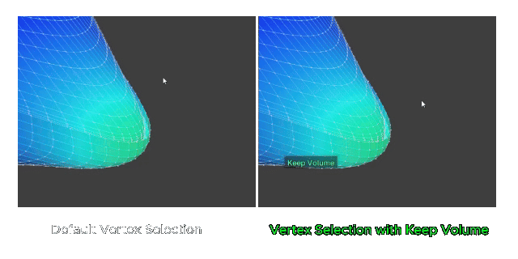
  <figcaption>When keep volume is enabled, you can select vertices across connected seams as if they were a single mesh.</figcaption>
</figure>

## UX&UI Improvement

#### - Update Behavior Across Vertex Selection and Brush Mode

<figure markdown>
  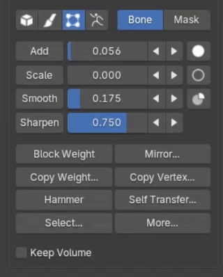
  <figcaption>hammer weight, self transfer, and copy vertex weight will now only show up in vertex mode.</figcaption>
</figure>

<figure markdown>
  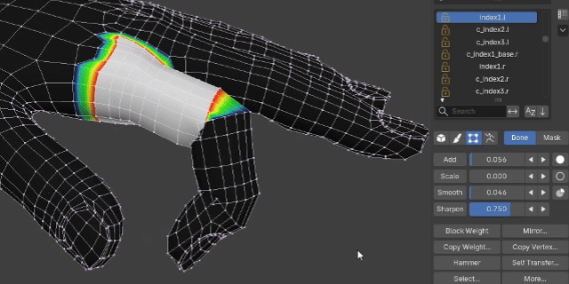
  <figcaption>If you have a vertex selection and switch to brush mode, it will automatically isolate the selected area.</figcaption>
</figure>

!!! note
    To keep things clean, we removed add vertex selection, remove selection, and hide/unhide mesh features from brush mode. Those tasks now belong fully to vertex mode.

#### - Weight Steps

<figure markdown>
  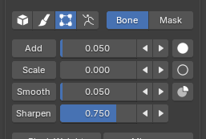
  <figcaption>Added step buttons for sliders in the N-panel.</figcaption>
</figure>

<figure markdown>
  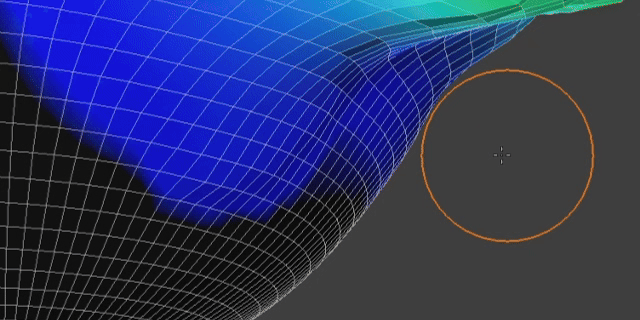
  <figcaption>When increasing weight steps using add weight, values go up smoothly. This makes weights easy to control, prevents values from blowing up, and fits the style of each weight operation.</figcaption>
</figure>

#### - Refine Slider Pop-up UI

<figure markdown>
  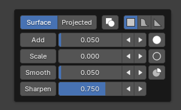
  <figcaption>Brush Mode - Right Click Popup Weight Slider</figcaption>
</figure>

<figure markdown>
  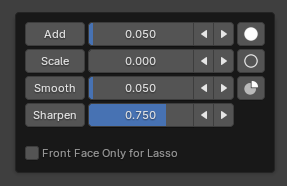
  <figcaption>Vertex Mode - Right Click Popup Weight Slider</figcaption>
</figure>

#### - Select Multiple Bones Faster with Lasso

<figure markdown>
  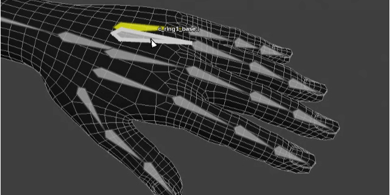
  <figcaption>Click and drag around the bones to automatically use lasso selection.</figcaption>
</figure>

#### - Add Bone HUD Color Customization

<figure markdown>
  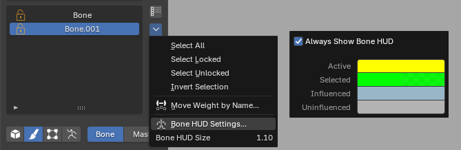
  <figcaption>You now can set the color of bones directly in the viewport.</figcaption>
</figure>

#### - Add Mirror to All Layers Option

<figure markdown>
  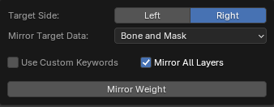
  <figcaption>Added a "mirror to all layers" option. Since most characters are symmetrical, turning this on ensures you never forget to mirror other layers and saves time from having to select every layer manually.</figcaption>
</figure>

#### - Add Show Shortcut Hint Option

<figure markdown>
  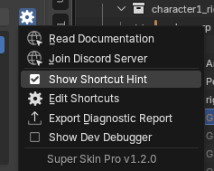
  <figcaption>You can now toggle shortcut hints on and off through the add-on settings button.</figcaption>
</figure>

## Other Improvements

- Improved smooth weight to work much better on dense topology meshes without needing overly high smooth settings.
- Improved the block weight algorithm for the face ring option.
- Improved the UI so self-transfer is easier to use without needing to toggle out to set a new source.
- Improved camera rotation to be more easier to control.
- Improved mirror weight performance.
- Removed smooth and repeat options from block weight since they duplicated the regular smooth buttons in the N-panel.
- Fixed a bug where block weight popups could not edit past values if a bone was selected after using block weight.
- Fixed the right-click popup in brush and vertex modes where settings would close immediately after changing them.
- Fixed shortcut bugs where add-on shortcuts leaked into native Blender weight paint mode.
- Fixed vertex weight operation gestures to be more compatible with pen tablets.
- Prevented native brush settings popups from showing up when pressing Alt+F, Shift+F, or Ctrl+F.

# 1.1.7

- Fixed: While weight painting, orbiting now rotates around the bone you last selected or the spot you last painted.

- Fixed: The Bake popup is shorter and narrower, with a Bake button instead of OK.

<figure markdown>
  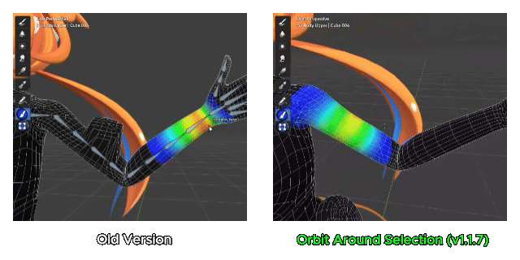
  <figcaption>Improved viewport orbiting around selection in v1.1.7</figcaption>
</figure>

# 1.1.6

- Fixed: with Orbit Around Selection turned on, orbiting during weight painting rotated around the character’s origin. It now rotates around the view center.

# 1.1.5

- Fixed: Pressing Numpad . during Weight Paint mode now centers the view on the mesh weighted to the active bone, allowing orbiting directly around that bone.

- Fixed: The Bone HUD skeleton is now rendered beneath the viewport HUD text to keep the text readable.

# 1.1.4

- Fixed: Importing weights no longer opens the file browser a second time after the import completes.

- Import now opens the file browser directly. Import settings (Method, Preserve Existing Layers) are in an Options section of the file browser's side panel.

- Import and Export are only enabled when a mesh is selected in the viewport. Export also requires the mesh to contain layer data.

# 1.1.3

* Add, Scale and Smooth now show a warning in the status bar when weight could not be distributed or pulled from other bones, or when Smooth found nothing to change, with a hint that some bones may be locked

* Edit Weight Mode now shows how many vertices are hidden at the bottom of the viewport until they are revealed

* The Deform Bones list is now locked outside Edit Weight Mode and can only be used while editing weights

* Select Locked and Select Unlocked now show a message when no bone matches

* Fixed Select Locked and Select Unlocked clearing the current bone selection when no bone matched

* Fixed the add-on panel shifting up slightly when switching to Pose Mode

# 1.1.2

* Improve toast HUD for Limit Total, Normalize, and Selection tools

* Fix "Weight brush not found" warning when entering Weight Paint mode

* Add documentation link to the add-on manifest and remove the Gumroad link button from the UI

# 1.1.1

* Restore the "Preserve Existing Layers" option in the Import Weight dialog

# 1.1.0 ( Minor Update )

### Mirror Weight Settings Update

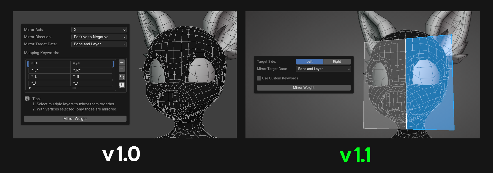 

* Since Blender mostly mirrors in the X-axis anyway, we made the mirror weight options simpler.
* Added a target side HUD preview: the blue plane area shows the target side for mirroring.
* The "Use Custom Keywords" option is now an optional setting, intended only for users who use keywords that differ greatly from the standard ones. General users no longer need to configure this.

### Bone Hud Update

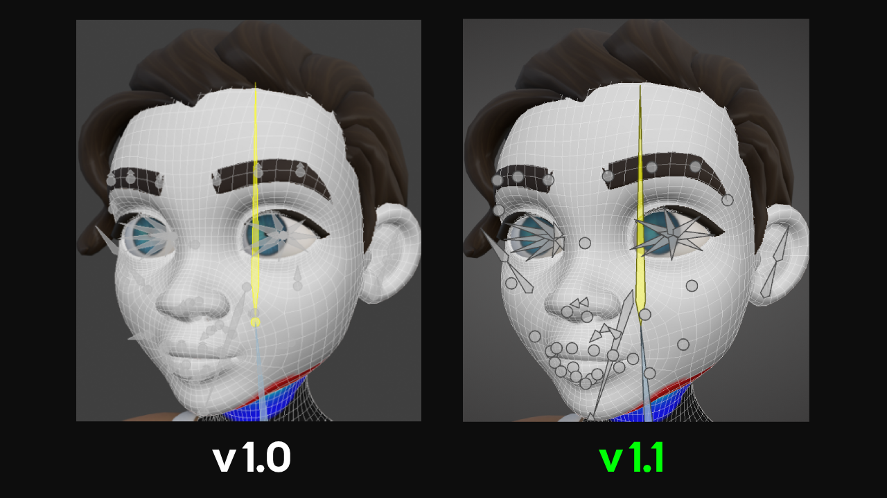 

* Improved the Bone HUD display to make it clearer to see.

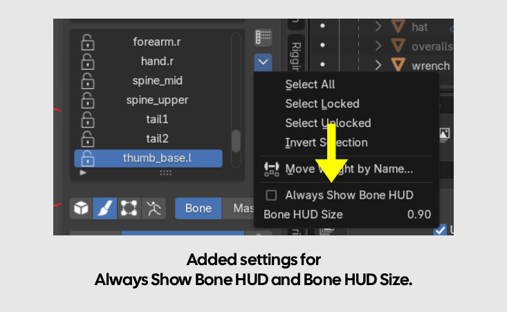 

* Added an option for "Always show bone display" to keep the Bone HUD visible all the time, located in the More Button next to the Deform Bone List (enabled by default).
* Moved the option for [adjusting Bone Size](bone_picker.md) into the More Button of the Deform Bone List as well.

#### Selection Update

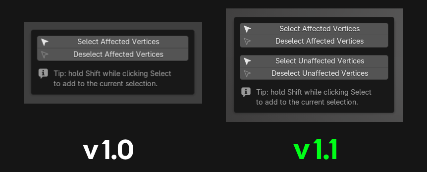 

* Added options to select unaffected vertices / deselect unaffected vertices for greater flexibility in use.

#### Others Bug fix and improve

* We improved the Transfer Weight options and behavior to make them easier to understand. You can read more in [Weight Transfer](object_tools.md)
* The Transfer Weight list and Active Mesh list now support selecting multiple items at once.
* Improved the system so it can smooth between existing bone weights and empty weight areas.
* Now supports Apple M-Series.
* Improved the popup width to auto-size according to the item names automatically.
* Improved icons to clearly distinguish between meshes using layer-based skin weights and native weights.

# 1.0.13

- Weight Transfer fix: when “Use Selected Vertices Only” is on for the source, the mask is now taken from the same selected area as the weight. Before, it could come from the nearest unselected area.
- Improved Mask Color to see more clear.
- Fix deform bone list , weight color display error when amarture have no deform bones

# 1.0.12

- Improved performance when applying weights.
- Fixed skin weights breaking after editing meshes.

# 1.0.11

- Entering Blender's native Weight Paint Mode no longer forces the add-on mode, preserving standard workflows for non-deform vertex groups.

# 1.0.10

- Added a status for meshes with layer data but missing an armature modifer.
- Added pressure sensitivity toggles for brush size, hardness, and strength.
- Added a Normalize Weights button to the Limit Total popup.
- Increased the maximum brush size limit for surface brushes.
- Fixed an issue where applying weights affected non-deform vertex groups. (Crucial Bug)

# 1.0.9

- Added a button to switch to Object Mode.
- Added a fade-out effect when exit from Bone Picker.
- Added a Clear button to the Transfer Settings popup.
- Improved add-on performance when switching layers and smoothing weights.
- Fixed Armature not hiding when entering Weight Paint mode.
- Fixed Smoothing weight error when increast to extreme values.

# 1.0.8

- Major UI redesign.
- Added shortcut customization to the Settings button.
- Added new features: "Set Total" (limit max bone influences) and "Hammer" (average vertex weights).
- Removed auto-update feature.
- Improve add-on performances.

# 1.0.7

* Improved the bind mesh dropdown in the List Viewer to be easier to use — see [Clean-up Layer Data](bindmesh.md) for details.
* Improved the [Weight Transfer](object_tools.md#weight-transfer) interface to be easier to use.

# 1.0.6

* **Shortcut Guide:** Press <kbd>Alt</kbd> + <kbd>4</kbd> while editing to toggle the Shortcut Guide.
* **Mask Edit Toggle:** Press <kbd>Alt</kbd> + <kbd>1</kbd> while editing to toggle Mask Edit mode.
* **Selection Persistence:** Exiting Mask Edit mode now preserves all active selections in the Deform Bone list.
* **Repeat Last Operation:** Added support for <kbd>Shift</kbd> + <kbd>R</kbd> to repeat the most recent Apply Weight operation.
* **UI Improvements:** Enhanced the user interface for both the Layer List and Deform Bone List sections.

**Bug Fixes :**

* **Multi-Color Mode:** Fixed display updates to ensure higher accuracy when using Mirror Weight and Auto Assign Weight.
* **Scale Weight Distribution:** Improved the scaling behavior to distribute weight more intelligently based on the rig hierarchy.

# 1.0.5

- Bone Picker now shows a header text indicating that bone picking mode is active.
- Bone Picker now displays the name of the hovered bone.
- Bone Picker has a redesigned color scheme for showing bone selection status.
- Improved performance when hovering bones with Multi Color mode enabled.
- Extended add-on support to Blender 4.2 LTS and newer.

**Bug Fixes :**

- Fixed the Viewport Overlay not being restored when exiting Edit Weight mode back to the user's normal edit mode.
- Fixed the Initialize system running again automatically when selecting a mesh.
