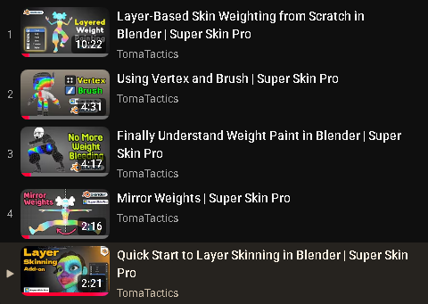
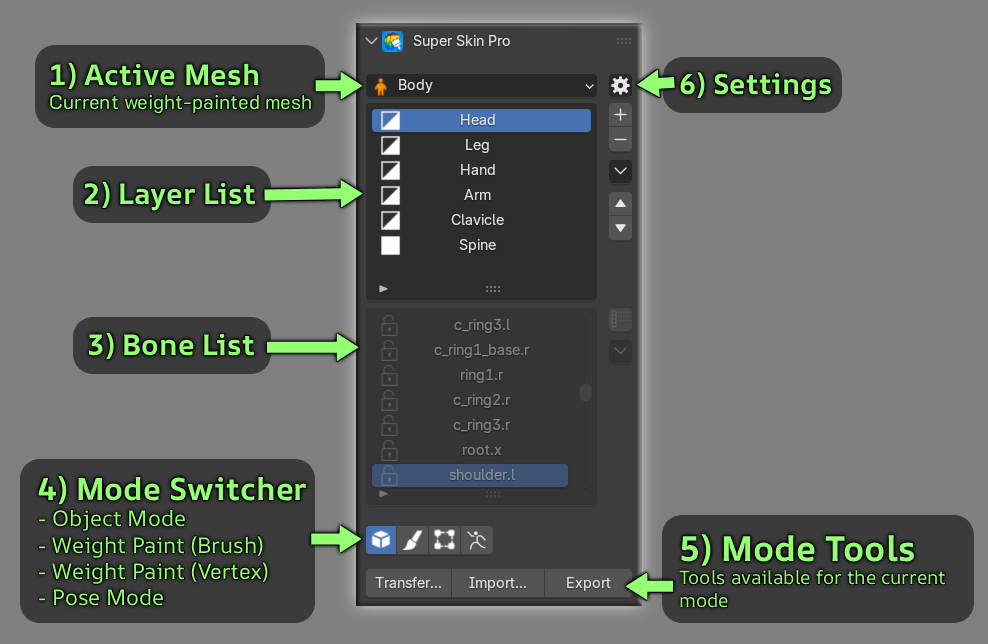

# Quick Start
For a quick guide on how to use the add-on, watching all the videos in this playlist should be more than enough to get you started:

[👉 Watch Super Skin Pro Tutorials Playlist](https://www.youtube.com/playlist?list=PLe-1umuorC5Q)

<figure markdown>
  
  <figcaption>Super Skin Pro YouTube Tutorial Playlist by tomatactics</figcaption>
</figure>

In the next section below, we’ll take an in-depth look at the interface and its features.

- - -

# Interface Overview

<figure markdown>

</figure>

#### 1) Active Bind Mesh

Displays the currently selected mesh and provides the option to [Bake Layer Data to Blender Native](bindmesh.md).

- - -

#### 2) Layer List 

Displays all skin weight layers. You can add, delete, reorder, duplicate, merge, and toggle the visibility of each layer. [Watch Layer Tutorial](https://youtu.be/PYMJwbvAdoY)

- **Enable / Disable:** Toggle layer activation by clicking the icon in front of the layer item.
- **Rename:** Double-click the layer name to rename it.

- - -

#### 3) Bone List 

Displays the active deform bones for the selected layer.

- **Lock / Unlock:** Click the lock icon in front of any bone to prevent [weight bleeding](https://youtu.be/B4HqxA83n0k).
- **Focus Viewport:** Double-click a bone to focus on it in the 3D viewport.
- **Filter Influenced Bones:** Toggle via the button in the right menu to display only bones with weights.

Notes:

1. In Weight Paint Mode, you can [select bones through the viewport](bone_picker.md).

2. Both the bone and layer lists support the following shortcuts:

<kbd>Ctrl</kbd> + <kbd>Click</kbd>: Add or remove items individually

<kbd>Shift</kbd> + <kbd>Click</kbd>: Select a range of items

<kbd>Ctrl</kbd> + <kbd>A</kbd> or <kbd>Alt</kbd> + <kbd>Shift</kbd> + <kbd>Click</kbd>: Select all items in the list

<kbd>Ctrl</kbd> + <kbd>I</kbd>: Invert selection

- - -

#### 4) Mode Switcher

Quick buttons for switching between Object Mode, Weight Paint (Brush), Weight Paint (Vertex Selection), and Pose Mode.

- - -

#### 5) Mode Tools

Tools available for each mode:

[👉 Read More Details on Object Mode Tools](object_tools.md)

<figure markdown>
  
</figure>

[👉 Read More Details on Weight Paint Mode Tools](edit_tools.md)

<figure markdown>
  
</figure>